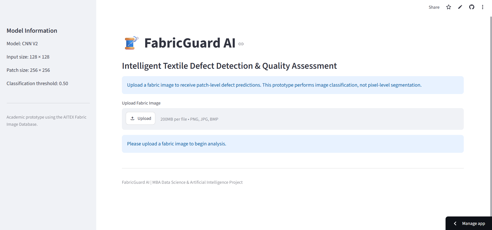
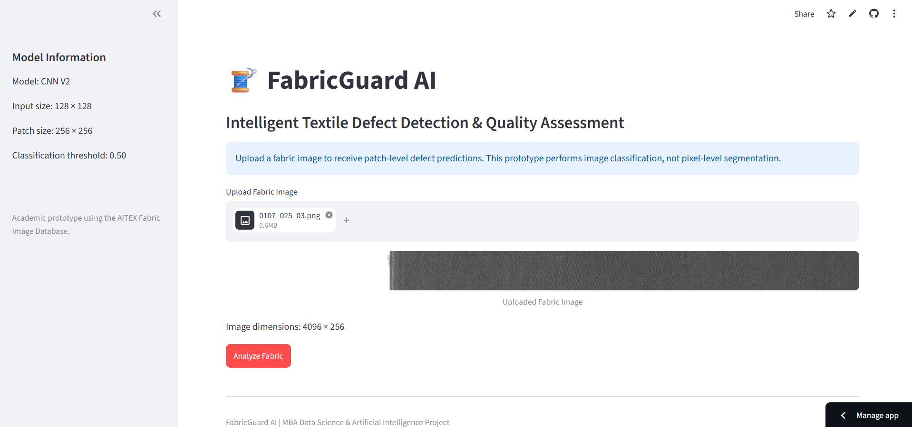
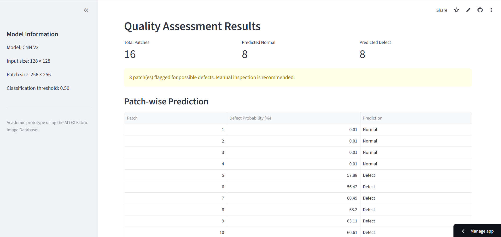
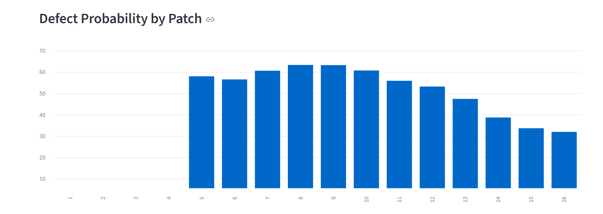
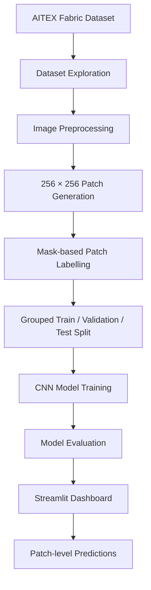

# 🧵 FabricGuard AI

### Intelligent Textile Defect Detection & Quality Assessment System

An AI-powered textile quality assessment prototype that uses Convolutional Neural Networks (CNN) to classify fabric image patches as **Normal** or **Potential Defect**.

<p align="center">
  <a href="https://fabricguard-ai-eiy2j2texmwhgthi8h6hju.streamlit.app/">
    
  </a>
  
  
  
</p>

---

## 🚀 Live Demo

Try the deployed application:

### 👉 [Open FabricGuard AI Dashboard](https://fabricguard-ai-eiy2j2texmwhgthi8h6hju.streamlit.app/)

Upload a fabric image and explore:

* Patch-wise defect predictions
* Defect probability scores
* Normal and potential defect patch counts
* Downloadable prediction results

---


## 📸 Application Preview

The dashboard allows users to upload fabric images and view patch-level quality predictions.

### 1. Main Dashboard



### 2. Uploaded Fabric Image



### 3. Quality Assessment Results



### 4. Patch-wise Predictions




---

## 📌 Project Overview

Textile quality inspection is an important stage in fabric manufacturing. Defects such as holes, stains, broken threads, and irregular patterns can affect product quality.

Traditional inspection can require significant manual effort. FabricGuard AI explores how deep learning can support textile quality assessment by classifying image patches.

The system uses the AITEX Fabric Image Database and a CNN-based classification approach.

**Important:** This is an academic prototype. It performs patch-level classification, not pixel-level defect segmentation.

---

## 🎯 Project Objectives

* Develop a CNN-based textile defect classification system.
* Preprocess high-resolution fabric images into smaller patches.
* Reduce data leakage using source-image-level splitting.
* Evaluate model performance using classification metrics.
* Build an interactive Streamlit dashboard.
* Explore the practical application of AI in textile quality assessment.

---

## 🗂️ Dataset Information

**Dataset Name:** AITEX Fabric Image Database

**Dataset Source:** [Download Dataset from Kaggle](https://www.kaggle.com/datasets/nexuswho/aitex-fabric-image-database)

**Official Source:** [AITEX Official Website](https://www.aitex.es/afid/)

| Dataset Category            | Number of Images |
| --------------------------- | ---------------: |
| Defect Images Found         |              106 |
| Normal Images Found         |              141 |
| Mask Images Found           |              107 |
| Total Extracted Image Files |              354 |

One defect image was skipped because its corresponding mask was missing.

### Preprocessing Summary

| Metric                  |    Result |
| ----------------------- | --------: |
| Processed Source Images |       246 |
| Total Image Patches     |     3,935 |
| Normal Patches          |     3,750 |
| Defect Patches          |       185 |
| Patch Dimensions        | 256 × 256 |

High-resolution fabric images were divided into smaller 256 × 256 patches. Each patch was assigned a classification label.

---

## 🔄 Project Workflow



---

## 🧠 Model Architecture

Two CNN versions were developed and evaluated.

### CNN V1

* Convolutional layers: 32, 64, 128 filters
* MaxPooling layers
* Global Average Pooling
* Dense layer with 64 units
* Dropout: 0.4
* Sigmoid output layer
* Adam optimizer
* Binary cross-entropy loss

### CNN V2

* Four convolutional blocks: 32, 64, 128, 256 filters
* Batch Normalization
* ReLU activation
* MaxPooling
* Global Average Pooling
* Dense layer with 128 units
* Dropout: 0.4
* Sigmoid output layer
* Data augmentation
* Class-weight balancing
* Early Stopping and Learning Rate Reduction

---

## 📊 Model Performance

Evaluation was performed on a held-out test set.

| Evaluation Metric | CNN V1 | CNN V2 |
| ----------------- | -----: | -----: |
| Accuracy          | 65.48% | 81.05% |
| Precision         |  8.92% | 11.93% |
| Recall            | 65.52% | 44.83% |
| F1-Score          | 15.70% | 18.84% |
| PR-AUC            | 10.09% | 11.31% |

### CNN V2 Confusion Matrix

| Actual / Predicted | Normal | Defect |
| ------------------ | -----: | -----: |
| Normal             |    466 |     96 |
| Defect             |     16 |     13 |

### Performance Interpretation

CNN V2 improved accuracy, F1-score, and PR-AUC compared with CNN V1 at the default 0.50 threshold.

However, defect precision remains low. This means many patches flagged as potential defects may actually be normal.

The model is therefore experimental and requires further improvement before any industrial application.

---

## 🖥️ Streamlit Dashboard Features

The interactive application provides:

* Fabric image upload
* Automatic image patch generation
* CNN-based patch classification
* Normal and potential defect counts
* Patch-wise defect probabilities
* Visual prediction summaries
* CSV download of prediction results

### Example Dashboard Output

| Assessment Metric |  Example Result |
| ----------------- | --------------: |
| Uploaded Image    | 0020_016_03.png |
| Image Dimensions  |      4096 × 256 |
| Total Patches     |              16 |
| Predicted Normal  |               7 |
| Predicted Defect  |               9 |

These are predictions for one uploaded sample, not model accuracy or confirmed defect counts.

---

## 🛠️ Technology Stack

| Category         | Technologies              |
| ---------------- | ------------------------- |
| Programming      | Python                    |
| Deep Learning    | TensorFlow, Keras         |
| Data Processing  | NumPy, Pandas             |
| Image Processing | Pillow                    |
| Visualization    | Plotly                    |
| Machine Learning | Scikit-learn              |
| Web Application  | Streamlit                 |
| Version Control  | Git, GitHub               |
| Deployment       | Streamlit Community Cloud |

---

## 📁 Project Structure

```text
FabricGuard-AI/
│
├── dashboard/
│   └── app.py
│
├── src/
│   ├── preprocessing.py
│   ├── split_dataset.py
│   ├── train_cnn.py
│   ├── train_cnn_v2.py
│   ├── tune_threshold.py
│   └── evaluate_tuned_model.py
│
├── data/
│   └── processed/
│       └── patches/
│
├── models/
│   ├── fabricguard_cnn.keras
│   └── fabricguard_cnn_v2.keras
│
├── outputs/
│   └── metrics/
│
├── docs/
│   └── images/
│       └── fabricguard-dashboard.png
│
├── requirements.txt
├── .gitignore
└── README.md
```

---

## ⚙️ Installation and Setup

### 1. Clone the Repository

```bash
git clone https://github.com/swagata-dsai/FabricGuard-AI.git
```

### 2. Navigate to the Project

```bash
cd FabricGuard-AI
```

### 3. Create a Virtual Environment

```bash
python -m venv .venv
```

### 4. Activate the Environment

Windows PowerShell:

```powershell
.venv\Scripts\Activate.ps1
```

### 5. Install Dependencies

```bash
pip install -r requirements.txt
```

### 6. Run the Streamlit Application

```bash
streamlit run dashboard/app.py
```

---

## ⚠️ Limitations

* The dataset contains relatively few defect examples.
* The classes are highly imbalanced.
* Defect prediction precision is low.
* Predictions are made at patch level, not pixel level.
* The model is not validated for industrial production use.
* Manual inspection is recommended for flagged patches.

---

## 🔮 Future Improvements

* Expand the training dataset.
* Apply stronger image augmentation.
* Experiment with transfer learning.
* Improve defect precision and recall.
* Explore segmentation models such as U-Net for pixel-level localization.
* Add explainable AI visualizations such as Grad-CAM.
* Improve dashboard reporting and quality analytics.

---

## 👩‍💻 Author

**Swagata Das**
MBA – Data Science and Artificial Intelligence
Chandigarh University

GitHub: [@swagata-dsai](https://github.com/swagata-dsai)

---

## ⭐ Acknowledgement

This project was developed as an academic exploration of deep learning applications in textile quality assessment using the AITEX Fabric Image Database.

**FabricGuard AI — Exploring smarter textile quality assessment through AI.**


