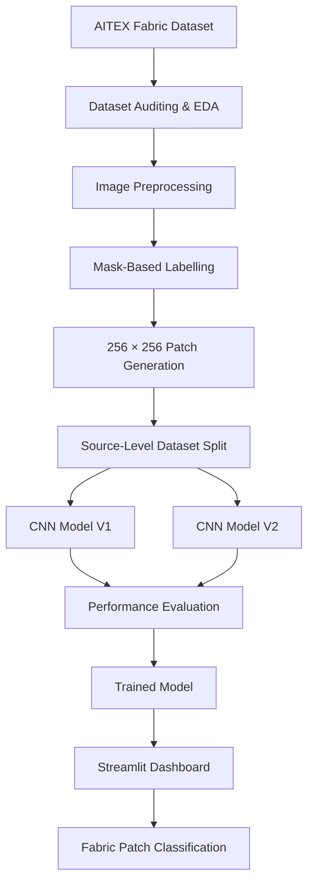

<div align="center">

# 🧵 FabricGuard AI

### Intelligent Textile Defect Detection & Quality Assessment

**Deep Learning | Computer Vision | CNN | TensorFlow | Streamlit**

An AI-powered academic prototype that classifies fabric image patches as Normal or Potentially Defective using Convolutional Neural Networks.

<br>


<br>

### 🔗 Quick Access

[📂 GitHub Repository](https://github.com/swagata-dsai/FabricGuard-AI) · [🖥️ Dashboard Source Code](https://github.com/swagata-dsai/FabricGuard-AI/blob/main/dashboard/app.py) · [🚀 Streamlit Community Cloud](https://share.streamlit.io/)

**Live Demo:** Not deployed yet. The public app URL will be added after deployment.

</div>

---

## 📌 01. Project Overview

FabricGuard AI is a Deep Learning and Computer Vision project designed to explore automated textile defect screening.

Traditional textile inspection often depends on manual observation, which can be time-consuming and inconsistent.

This project applies CNN-based image classification to identify fabric patches that may contain defects.

### What does FabricGuard AI do?

| Input             | Processing              | Output                    |
| ----------------- | ----------------------- | ------------------------- |
| Fabric Image      | Image preprocessing     | Image patches             |
| Defect Mask       | Binary mask labelling   | Patch labels              |
| Image Patches     | CNN classification      | Normal / Defect           |
| Prediction Scores | Streamlit visualization | Quality assessment report |

> **Scope:** This is a patch-level binary classification system. It does not perform pixel-level defect segmentation or guarantee exact defect localization.

---

## 🎯 02. Project Objectives

* Build an end-to-end textile defect classification pipeline.
* Analyze and preprocess the AITEX Fabric Image Database.
* Generate 256 × 256 patches from large fabric images.
* Create binary labels using defect masks.
* Prevent data leakage through source-image-level splitting.
* Train and compare two CNN architectures.
* Evaluate performance using classification metrics.
* Develop an interactive Streamlit dashboard.

---

## 📊 03. Dataset at a Glance

**Dataset:** AITEX Fabric Image Database

| Dataset Information     | Value |
| ----------------------- | ----: |
| Defect Images           |   106 |
| Normal Images           |   141 |
| Mask Images             |   107 |
| Total Image Files       |   354 |
| Processed Source Images |   246 |
| Generated Image Patches | 3,935 |
| Defect Patches          |   185 |
| Normal Patches          | 3,750 |

### Patch Distribution

| Class     | Label |   Patches |
| --------- | ----: | --------: |
| Normal    |     0 |     3,750 |
| Defect    |     1 |       185 |
| **Total** |       | **3,935** |

The dataset is highly imbalanced, with a smaller number of defect patches.

---

## ⚙️ 04. Project Workflow



---

## 🧠 05. Deep Learning Models

Two CNN architectures were developed and evaluated.

### CNN V1

* Three convolutional layers.
* 32, 64 and 128 filters.
* MaxPooling layers.
* Global Average Pooling.
* Dense layer with 64 neurons.
* Dropout regularization.
* Sigmoid output for binary classification.

### CNN V2

* Four convolutional blocks.
* 32, 64, 128 and 256 filters.
* Batch Normalization.
* ReLU activation.
* MaxPooling.
* Global Average Pooling.
* Dense layer with 128 neurons.
* Dropout regularization.
* Sigmoid output.

### Training Configuration

| Parameter      |              CNN V1 |              CNN V2 |
| -------------- | ------------------: | ------------------: |
| Input Size     |           128 × 128 |           128 × 128 |
| Batch Size     |                  32 |                  32 |
| Maximum Epochs |                  25 |                  15 |
| Optimizer      |                Adam |                Adam |
| Learning Rate  |               0.001 |              0.0003 |
| Loss           | Binary Crossentropy | Binary Crossentropy |
| Class Weights  |            Balanced |            Balanced |

---

## 📈 06. Model Performance

Both models were evaluated on the same held-out test dataset of **591 patches**.

### CNN V1 vs CNN V2

| Evaluation Metric |     CNN V1 |     CNN V2 |
| ----------------- | ---------: | ---------: |
| Accuracy          |     65.48% | **81.05%** |
| Precision         |      8.92% | **11.93%** |
| Recall            | **65.52%** |     44.83% |
| F1-Score          |     15.70% | **18.84%** |
| PR-AUC            |     10.09% | **11.31%** |

### CNN V2 — Confusion Matrix

| Actual / Predicted | Normal | Defect |
| ------------------ | -----: | -----: |
| Normal             |    466 |     96 |
| Defect             |     16 |     13 |

### Key Findings

* CNN V2 achieved 81.05% test accuracy.
* F1-score improved from 15.70% to 18.84%.
* PR-AUC improved from 10.09% to 11.31%.
* Defect precision remains low.
* Further model development is needed before practical industrial use.

> Accuracy alone is not sufficient for this imbalanced dataset. Precision, recall, F1-score and PR-AUC are also important.

---

## 🖥️ 07. Interactive Streamlit Dashboard

FabricGuard AI includes an interactive dashboard built using Streamlit.

### Dashboard Capabilities

| Feature            | Description                                |
| ------------------ | ------------------------------------------ |
| Image Upload       | Upload PNG, JPG, JPEG or BMP fabric images |
| Patch Generation   | Divide images into 256 × 256 patches       |
| CNN Prediction     | Classify patches using CNN V2              |
| Defect Probability | Display model-generated probabilities      |
| Prediction Summary | Show normal and defect patch counts        |
| Results Table      | View individual patch predictions          |
| CSV Export         | Download prediction results                |

### Run the Dashboard Locally

```bash
streamlit run dashboard/app.py
```

Open:

```text
http://localhost:8501
```

**Dashboard source:** [View app.py](https://github.com/swagata-dsai/FabricGuard-AI/blob/main/dashboard/app.py)

**Public deployment:** [Open Streamlit Community Cloud](https://share.streamlit.io/)

A public application URL will be added here after deployment.

---

## 📥 08. Dataset & CSV Files

The following processed dataset split files are available in the GitHub repository:

| File                                                                                                                  | Description                  |
| --------------------------------------------------------------------------------------------------------------------- | ---------------------------- |
| [Training CSV](https://github.com/swagata-dsai/FabricGuard-AI/blob/main/data/processed/splits/train.csv)              | Training patch metadata      |
| [Validation CSV](https://github.com/swagata-dsai/FabricGuard-AI/blob/main/data/processed/splits/validation.csv)       | Validation patch metadata    |
| [Testing CSV](https://github.com/swagata-dsai/FabricGuard-AI/blob/main/data/processed/splits/test.csv)                | Held-out test patch metadata |
| [Confusion Matrix CSV](https://github.com/swagata-dsai/FabricGuard-AI/blob/main/outputs/metrics/confusion_matrix.csv) | CNN V1 test confusion matrix |

**Note:** These CSV links point to the repository files. If GitHub shows a 404, verify that the corresponding file has been committed and pushed.

The original AITEX dataset is not included in this repository.

---

## 🗂️ 09. Project Structure

```text
FabricGuard-AI/
│
├── dashboard/
│   ├── app.py
│   └── pages/
│
├── data/
│   └── processed/
│       └── splits/
│           ├── train.csv
│           ├── validation.csv
│           └── test.csv
│
├── models/
│   ├── fabricguard_cnn.keras
│   └── fabricguard_cnn_v2.keras
│
├── outputs/
│   ├── figures/
│   ├── reports/
│   └── metrics/
│
├── src/
│   ├── preprocessing.py
│   ├── split_dataset.py
│   ├── train_cnn.py
│   ├── train_cnn_v2.py
│   ├── tune_threshold.py
│   └── evaluate_tuned_model.py
│
├── tests/
├── .gitignore
├── README.md
└── requirements.txt
```

---

## 💻 10. Installation & Setup

### Clone the Repository

```bash
git clone https://github.com/swagata-dsai/FabricGuard-AI.git
cd FabricGuard-AI
```

### Create Virtual Environment

```powershell
python -m venv .venv
```

### Activate Environment

```powershell
.\.venv\Scripts\Activate.ps1
```

### Install Dependencies

```bash
pip install -r requirements.txt
```

### Run the Application

```bash
streamlit run dashboard/app.py
```

The AITEX dataset must be downloaded and configured separately to reproduce preprocessing and model training.

---

## 🛠️ 11. Technology Stack

| Area             | Tools                       |
| ---------------- | --------------------------- |
| Programming      | Python                      |
| Deep Learning    | TensorFlow, Keras           |
| Data Processing  | NumPy, Pandas               |
| Machine Learning | Scikit-learn                |
| Image Processing | Pillow, OpenCV              |
| Visualization    | Matplotlib, Seaborn, Plotly |
| Dashboard        | Streamlit                   |
| Version Control  | Git, GitHub                 |

---

## ⚠️ 12. Limitations

1. The dataset contains relatively few defect patches.
2. The class distribution is highly imbalanced.
3. The model performs patch-level classification, not pixel-level segmentation.
4. False-positive predictions remain a challenge.
5. Generalization to unseen textile materials and real-world factory environments has not been established.
6. The current implementation is an academic prototype, not a production-ready inspection system.

---

## 🚀 13. Future Enhancements

* Expand the training dataset with more textile samples.
* Improve defect detection precision and recall.
* Experiment with transfer learning.
* Implement U-Net for pixel-level defect segmentation.
* Integrate Grad-CAM for model explainability.
* Explore real-time camera-based fabric inspection.
* Deploy the dashboard publicly.

---

## 👩‍💻 14. Author

**Swagata Das**

MBA – Data Science and Artificial Intelligence
Chandigarh University

**Project Domain:** Deep Learning | Computer Vision | Textile Quality Assessment

### Connect & Explore

[GitHub Profile](https://github.com/swagata-dsai) · [Project Repository](https://github.com/swagata-dsai/FabricGuard-AI)

---

<div align="center">

### FabricGuard AI

**Exploring AI-driven solutions for smarter textile quality assessment.**

*Academic Deep Learning Project*

</div>


